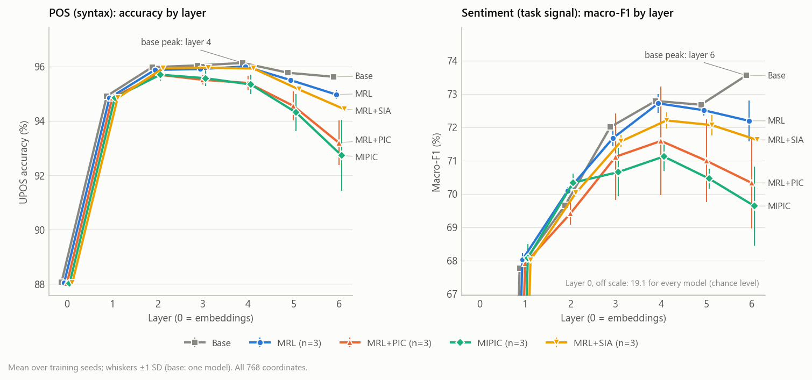
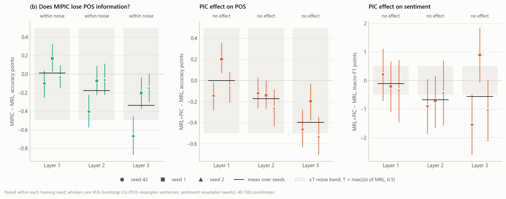
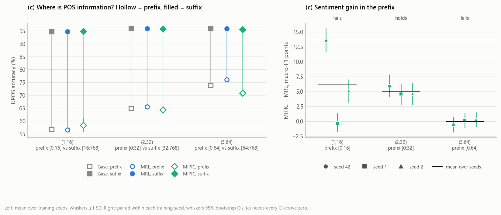

# Syntax preservation: lower layers hold syntax, and PIC leaves it intact

This folder tests the MIPIC paper's claim in the title: that lower Transformer layers hold syntax, and that PIC leaves it intact. The work is done in steps, one commit per step. This README records what each step does and why, and is updated as each step is finished.

## The claim being tested

The MIPIC paper (arXiv:2604.24374v1) motivates PIC with three statements it never measures:

- §1, p.2: "lower Transformer layers predominantly encode low level linguistic features such as syntax and basic semantics, while higher layers increasingly capture task specific and discriminative signals (Jawahar et al., 2019; Liu et al., 2019)."
- §1, p.2: "PIC allows the remaining dimensions to continue modeling low level and general linguistic features."
- §3.3, p.6: supervision is restricted to the prefix "while preserving low-level features and representational flexibility in the remaining space."

PIC supervises only the [CLS] prefix at fixed (layer, width) checkpoints: `hidden_states[l][:, 0, :d]` for (1,16), (2,32), (3,64), (4,256), (5,512), (6,768) ([losses/pic_loss.py](../../losses/pic_loss.py)). Because the encoder weights are shared, this also changes every token's representation, and the paper doesn't check what it does to them.

**Hypothesis.**
- **(a)** In TinyBERT-6L, POS information peaks at a lower layer than sentiment information.
- **(b)** MIPIC's early layers keep their POS information.
- **(c)** That information sits in the coordinates outside the PIC prefix.

## Result

Three training seeds of MRL, MRL+PIC, MIPIC and MRL+SIA, plus base TinyBERT; 676 probes. Details and caveats are in step 7, every number in [RESULTS.md](RESULTS.md).

| Rule | Verdict |
|---|---|
| (a) POS peaks at a lower layer than sentiment, base | **Supported**: POS peaks at layer 4, sentiment at layer 6 (POS first in 97% of bootstrap resamples) |
| (b) MIPIC keeps POS at layers 1–3 | **Supported**: MIPIC − MRL is +0.01, −0.18 and −0.34 points, all within the noise threshold of 0.5 |
| (c) POS outside the prefix, sentiment gain inside it | **Supported at 1 of 3 checkpoints**: holds at (2,32) in every seed; fails at (1,16), where one seed shows no gain, and at (3,64), where no seed does |
| Falsification check: PIC changes the early layers at all | **Falsified**: MRL+PIC's full-width layers 1–3 match MRL's within the noise threshold, for POS and for sentiment |

**By the decision rules, the hypothesis is falsified**, on the second criterion: PIC has no measurable effect on the full-width early layers. That also limits what (b) shows: MIPIC keeps POS at layers 1–3 largely because PIC hardly changes those layers at all.

PIC is far from inert, though; its effects are concentrated elsewhere:
- **In the small prefix it supervises.** At (2,32), MIPIC's prefix holds 4.6 to 5.9 macro-F1 points more sentiment than MRL's, in every seed. At (3,64), MIPIC's prefix holds 3.6 to 6.2 points less POS than MRL's, in every seed, with no sentiment gain in exchange.
- **In the late layers.** Compared with MRL, MIPIC loses 0.7, 1.2 and 2.2 points of POS accuracy at layers 4, 5 and 6, and 1.6 to 2.6 points of sentiment there, with every CI below zero in every seed.

The paper's statement that PIC preserves low-level features holds for the early layers, which PIC barely touches. It does not hold for the network as a whole.

## Test design

**Models.** Base TinyBERT-6L (`huawei-noah/TinyBERT_General_6L_768D`, no training), MRL, MRL+PIC and MIPIC. MRL+SIA is probed too, for completeness; the decision rules don't use it. The trained models are the `best.pt` checkpoints from `run_experiments.py` for training seeds 42, 1 and 2, the same models probed for sentiment in [layerwise_probe](../layerwise_probe/). Using the same models links the two results: layerwise_probe found that PIC adds sentiment signal at (1,16) and (2,32), and this test asks whether that gain coexists with intact POS information.

**Tasks.**

| Task | Data | Vector probed | Metric |
|---|---|---|---|
| POS (syntax) | UD English EWT r2.13, UPOS (17 tags) | First-subword vector of each word, `hidden_states[l][:, i, :]` | Accuracy |
| Sentiment (task signal) | `data/tweet_train.csv`, `data/tweet_test.csv` (3 classes) | [CLS] vector, `hidden_states[l][:, 0, :]` | Macro-F1 |

Layer l = 0 is the embedding output and l = 1…6 are the transformer layers. The sentiment files are the Kaggle Tweet Sentiment Extraction data used throughout this repository, not the official TweetEval benchmark (see the main [README](../../README.md)); see decision 1 below for why.

**Splits.**

| Task | Fit on | Choose C on | Report on |
|---|---|---|---|
| POS | UD EWT train (204,577 words) | UD EWT dev (25,149 words) | UD EWT test (25,094 words) |
| Sentiment | 90% of `tweet_train.csv` (stratified) | the other 10% (about 2,670 rows) | `tweet_test.csv` (3,432 rows), unchanged |

**Probes.** Multinomial logistic regression on frozen features, standardized with the statistics of the fitting split. The regularization strength C is chosen on the validation split from the fixed grid {0.001, 0.01, 0.1, 1, 10} (accuracy for POS, macro-F1 for sentiment; ties go to the smaller C), and the chosen model is scored on the test split. The objective is that of `evaluate.py`'s `LogisticRegression` (lbfgs, L2, at most 1,000 iterations), solved with full-batch L-BFGS in PyTorch (step 3 explains why). The standardization and the tuned C remove a bias of `evaluate.py`'s fixed, unscaled probe (C = 1): with one fixed C, features of larger scale are effectively regularized less, so that probe favours models whose features are larger, and the trained models' pooler features are about twice the scale of base's.

**Probe seeds.** Logistic regression is convex and the solver is deterministic, so refitting the same POS probe gives the same answer; POS gets one fit per cell. For sentiment, the probe seed sets the 90/10 validation split: 3 probe seeds (0, 1, 2) per cell, with the score averaged over them.

**Cells probed.**
1. **Layer profiles.** Layers 0–6 at full width (768D), for POS and for sentiment.
2. **Prefix vs suffix at the PIC checkpoints** (1,16), (2,32) and (3,64): the prefix [0:d] and the suffix [d:768], for POS (token vectors) and for sentiment ([CLS]).

**Decision rules.**
- **(a) supported** if, in base TinyBERT, the POS peak layer is earlier than the sentiment peak layer.
- **(b) supported** if MIPIC's POS accuracy at layers 1–3 is within seed noise of MRL's (defined below).
- **(c) supported** if, in MIPIC, POS(suffix) ≥ POS(prefix), while MIPIC's sentiment(prefix) is higher than MRL's at the same layer and width. Concretely, at each checkpoint (1,16), (2,32), (3,64): MIPIC's POS(suffix) − POS(prefix) ≥ 0 in every training seed, **and** MIPIC − MRL sentiment(prefix) has its 95% paired bootstrap CI above zero in every seed. (c) is supported if both hold at all three checkpoints; otherwise it is reported as "supported at k of 3 checkpoints". The peak in rule (a) is the layer with the highest full-width score, with ties going to the earlier layer.
- **Falsified** if MIPIC's POS accuracy at layers 1–3 drops below MRL's by more than seed noise (PIC damages low-level features), or if MRL+PIC and MRL give the same profiles (PIC has no measurable effect on early layers).

**Seed noise: the operational rule.** Applied separately at each layer l = 1, 2, 3, to POS accuracy at full width (768D):

1. For each training seed s, d_s = MIPIC_s − MRL_s (accuracy points), with its 95% paired bootstrap CI on the test words.
2. σ = sample standard deviation of MRL's accuracy across the 3 seeds.
3. Threshold T = max(2σ, 0.5 points).

| Verdict | Condition | Meaning |
|---|---|---|
| Damage | mean d < −T **and** the CI lies below zero in all 3 seeds | Falsifies (b) at that layer |
| Within noise | \|mean d\| ≤ T | Supports (b) at that layer |
| Inconclusive | anything else, e.g. a large drop in one seed only, or a drop that is significant in every seed but smaller than T | Reported as inconclusive, counted as neither support nor falsification |

(b) is supported if every layer 1–3 is "within noise", and falsified if any layer shows "damage".

**PIC has a measurable effect** (second falsification check) if, at any layer 1–3, for POS accuracy or sentiment macro-F1, MRL+PIC differs from MRL by more than T (computed the same way, with σ from MRL) with the CI excluding zero in the same direction in all 3 seeds. If no early cell meets this, MRL+PIC and MRL count as giving the same profiles.

Why this form:
- **Two kinds of noise.** The bootstrap covers test-set noise, which is tiny with 25k test words (about ±0.2 points) and would flag trivial gaps. σ covers training-seed noise, which is what "seed noise" means. The rule needs both: a gap must be larger than normal seed variation and consistent across seeds.
- **2σ** is the conventional "outside normal variation" threshold. With 3 seeds σ is itself uncertain, so 1σ would label ordinary run-to-run variation as damage.
- **The 0.5-point floor** (about 125 of 25,094 test words) is the smallest POS loss treated as meaningful. It stops a very small σ from turning a trivial gap into damage.
- **σ from MRL alone**, because MRL is the reference. Including MIPIC's own variation would let an unstable MIPIC raise the threshold and hide its own damage.
- **The "inconclusive" outcome** stops a weak test from being reported as support: (b) claims there is *no* difference, and with 3 seeds a plain t-test would almost never reject it.

**Statistics.** Mean ± std over training seeds, paired differences between models within each seed, and 95% paired bootstrap confidence intervals on the test set (1,000 resamples, seed 0). POS resamples whole test sentences (2,077), because words in one sentence are not independent and resampling single words would make the intervals too narrow; sentiment resamples test tweets (3,432) and averages macro-F1 over the 3 probe seeds in each resample.

## Decisions

Recorded before any trained-model results, so they can't be fitted to the outcome.

1. **Sentiment data: the repository's tweet files, with a validation split carved from train**. The official TweetEval benchmark (`cardiffnlp/tweet_eval`) matches the paper's wording and has a real validation split, but it was not chosen:
   - **Link to layerwise_probe.** Rule (c) compares MIPIC's and MRL's sentiment prefixes. layerwise_probe found that PIC raises sentiment at (1,16) and (2,32) on exactly this data and these checkpoints (Finding 6). Keeping the data fixed means this experiment can say whether that gain coexists with intact POS information, instead of comparing results from two datasets.
   - **Known overlap.** layerwise_probe already checked it ([FINDINGS.md](../layerwise_probe/FINDINGS.md), Finding 1, check 3): no test row is in the training corpus, and 3,000 training-corpus rows are in `tweet_train.csv` (11.2% of it), which can only help the trained models. TweetEval would need its own overlap check, because all 3,000 rows of the corpus source labelled `TWEET_EVAL_SENT` are in the Kaggle `tweet_train.csv`, so the label doesn't say where they came from.
   - **Cost.** Sentiment numbers are not comparable with the paper's. This is true of the whole repository already.
   - Rules (a) and (b) are expected to come out the same on either dataset; only (c) depends on this choice.
2. **Seed noise: T = max(2σ, 0.5 points), σ from MRL, consistent CIs in all 3 seeds**. The full rule and its reasons are under "Seed noise: the operational rule" above.
3. **Trained models: the existing `best.pt` checkpoints for seeds 42, 1 and 2**, the same ones layerwise_probe probed, rather than new training runs. They come from the unmodified `run_experiments.py`, so they are ordinary trained models; reusing them saves about 4.5 GPU hours and keeps the link to layerwise_probe's results.
   - **Location:** `MRL_LEXIS_H11_checkpoints/h11_probe/runs/seed{42,1,2}/checkpoints/{mrl,mrl_pic,mipic,mrl_sia}/best.pt` (not tracked in git). `best.pt` is the epoch chosen during training; `model.pt` beside it is the last epoch and is not used.
   - **Verified:** all 12 load strictly and differ from base. MIPIC seed 42, re-extracted here, reproduces layerwise_probe's saved test predictions at (layer 1, 16D) and the pooler at 768D, with 18 and 15 of 3,432 predictions different (54.50 vs 54.65 and 67.72 vs 67.77 macro-F1). The small differences come from CPU vs GPU arithmetic and scikit-learn 1.5.1 vs 1.9.0; the other seeds' MIPIC and seed 42's MRL and MRL+PIC score 10 to 20 points away at (1,16).
4. **Rule (c) and the bootstrap made concrete before any trained-model result.** The original wording of rule (c) named no statistical test, so the version under "Decision rules" fixes one in the style of the seed-noise rule: a direction that must hold in every seed, with the paired CI for the sentiment gain. The bootstrap resamples UD test sentences rather than words, for the reason under "Statistics".

**Expected sanity check.** At layer 0, [CLS] is the same vector for every sentence (the [CLS] token embedding plus position 0, then LayerNorm), so sentiment at layer 0 should be at chance. POS at layer 0 is a non-contextual word-embedding probe and should already be high.

## Steps

| Step | What it adds | Status |
|---|---|---|
| 1 | UD EWT loader: download, verify, parse; tests | Done |
| 2 | Feature extraction, layers 0–6: token first-subword vectors (UD EWT) and [CLS] vectors (tweets) | Done |
| 3 | Probes: layer profiles and prefix/suffix cells, for POS and sentiment; full run on base | Done |
| 4 | Launcher: extract → probe → delete features, for every model of the chosen seeds | Done |
| 5 | Paired bootstrap, cross-seed aggregation, decision rules (a), (b), (c) and the falsification checks | Done |
| 6 | Figures: layer profiles, seed-noise checks, prefix and suffix at the checkpoints | Done |
| 7 | Run on the trained checkpoints; write up the findings | Done |

### Step 1. UD English EWT loader

**Files.** [ud_data.py](ud_data.py), [test_ud_data.py](test_ud_data.py).

**What it does.**
- Downloads the three CoNLL-U files of UD English EWT, release **r2.13**, from the official GitHub repository into `experiments/syntax_preservation/data/ud_ewt/`, which is not tracked in git.
- Checks each file against a pinned SHA-256 hash, so every model and seed is probed on byte-identical data. A download is written to a temporary file and only renamed into place once its hash matches.
- Parses each sentence into words with their UPOS and XPOS tags. It keeps one entry per syntactic word and skips the two kinds of CoNLL-U line that are not words:
  - multiword-token ranges such as `1-2 don't`, whose parts (`do`, `n't`) are listed as separate words;
  - empty nodes such as `8.1`, which belong to enhanced dependencies and have no surface form.
- Checks the sentence and word counts of the release and that every UPOS tag is one of the 17 UD tags. UPOS labels use a fixed tag order, so label ids are identical everywhere. XPOS (Penn Treebank tags) is parsed as well, so hypothesis 1 can reuse the loader.

**Data.**

| Split | Sentences | Words | UPOS tags | XPOS tags |
|---|---:|---:|---:|---:|
| train | 12,544 | 204,577 | 17 | 49 |
| dev | 2,001 | 25,149 | 17 | 49 |
| test | 2,077 | 25,094 | 17 | 48 |

The most frequent tag, NOUN, covers 16.5% of test words; that is the majority-class baseline for POS accuracy.

**Run** (from the repository root):

```bash
python experiments/syntax_preservation/ud_data.py                    # download if needed, verify, print the table above
python -m pytest experiments/syntax_preservation/test_ud_data.py -q  # 6 passed (the real-data test is skipped until the download)
```

### Step 2. Feature extraction

**Files.** [extract_features.py](extract_features.py), [test_extract_features.py](test_extract_features.py).

**What it does.** For one encoder (base TinyBERT, or a trained checkpoint loaded with `experiments/layerwise_probe/load_encoder.py`), it runs every sentence through the frozen model once and saves, for every layer l = 0…6:

| Part | Rows | Vector saved per row | Labels saved |
|---|---:|---|---|
| `ud_train`, `ud_dev`, `ud_test` | one per UD word (204,577 / 25,149 / 25,094) | first subword of the word, `hidden_states[l][:, i, :]` | UPOS id, XPOS id, sentence index |
| `tweet_train`, `tweet_test` | one per tweet (26,732 / 3,432) | [CLS], `hidden_states[l][:, 0, :]` | sentiment label |

Files go to `experiments/syntax_preservation/features/<name>/` as `{part}_layer{l}.npy` (float32, 768 columns), plus the label arrays and a `meta.json` with the settings, the checkpoint's SHA-256, row counts and timings. Rows are in the original data order.

**Choices and why.**
- **First subword.** A word split into several subwords (e.g. "unbelievably" → `un`, `##bel`, …) is represented by its first subword, the usual convention for token-level probes. UD words are passed to the tokenizer pre-split (`is_split_into_words=True`), so word boundaries come from UD, not from the tokenizer.
- **No truncation of UD sentences.** The longest one is 337 tokens, below the model's 512 positions; the script stops rather than truncate if that ever changes. Tweets keep layerwise_probe's limit of 256 tokens (the longest tweet is 110), so tweet [CLS] vectors are the ones layerwise_probe probed.
- **Words with no subword** (e.g. a lone zero-width space) are dropped together with their labels and counted in `meta.json`. UD EWT r2.13 has none.
- **Length-sorted batches.** Sentences are grouped by token length, so little padding is computed: 1.8× faster than layerwise_probe's data-order batching on the same 3,200 tweets (22 vs 12 tweets/s on CPU). Padding is masked in attention, and the tests check that every vector matches encoding its sentence alone (to 1e-4).
- **Flat memory.** Vectors are copied straight into memory-mapped `.npy` files. This matters on CPU: there, `hidden_states[l][:, 0, :].cpu().numpy()` is a *view* that keeps the whole batch tensor alive, so code that keeps such views (as `experiments/layerwise_probe/extract_cls.py` does) grows by about 50 MB per batch until the machine runs out of memory and torch crashes. It is harmless on a GPU, where `.cpu()` copies.
- **Resumable.** Each part is written under `*.partial.npy` names and renamed when complete, and `meta.json` lists completed parts. A rerun skips them, so an interruption costs at most the part in progress. A rerun with different settings into the same folder is refused.

**Cost per model** (CPU, 16-thread laptop): about 6.1 GB of features; about 20–35 minutes (tweets 22–40/s, UD 29–50 sentences/s, depending on machine load). The features can be deleted once the model is probed (step 4).

**Run** (from the repository root):

```bash
python experiments/syntax_preservation/extract_features.py --name base --limit 50     # smoke test, seconds
python experiments/syntax_preservation/extract_features.py --name base                # full run
python experiments/syntax_preservation/extract_features.py --name mipic_s42 \
    --checkpoint MRL_LEXIS_H11_checkpoints/h11_probe/runs/seed42/checkpoints/mipic/best.pt
python -m pytest experiments/syntax_preservation/ -q                                  # 14 passed, about a minute on CPU
```

### Step 3. Probes

**Files.** [probe.py](probe.py), [test_probe.py](test_probe.py); results for base in [results/](results/).

**What it does.** For one model's features, it fits 13 cells per task: the layer profile (layers 0–6, all 768 coordinates) and the prefix [0:d] and suffix [d:768] at the PIC checkpoints (1,16), (2,32) and (3,64). POS gets one probe per cell; sentiment gets one per cell and probe seed, 52 probes in all. Each probe:

1. standardizes the features with the mean and standard deviation of its fitting split (coordinates that are constant there are centred, not scaled);
2. fits a logistic regression for each C in {0.001, 0.01, 0.1, 1, 10}, each from zero;
3. keeps the C with the best validation score (POS: accuracy on UD dev; sentiment: macro-F1 on the held-out 10%; ties go to the smaller C);
4. scores that model on the test split and saves its test predictions for the bootstrap in step 5.

**Why PyTorch for the logistic regression.** The objective is exactly that of `evaluate.py`'s `LogisticRegression` (multinomial, L2, intercept not penalized) with its stopping rule (largest gradient entry below 1e-4, at most 1,000 iterations), minimized with full-batch L-BFGS in PyTorch. scikit-learn's solver computes the multinomial loss on one thread and copies the features to float64, 1.26 GB for UD train alone; PyTorch uses every core in float32. On base, layer 6, all 768 coordinates, the two agree:

| C | Validation accuracy, PyTorch | Validation accuracy, scikit-learn | Time, PyTorch | Time, scikit-learn |
|---:|---:|---:|---:|---:|
| 0.001 | 94.89 | 94.89 | 8 s | 46 s |
| 0.01 | 95.49 | 95.49 | 10 s | 47 s |
| 0.1 | 95.40 | 95.41 | 14 s | 57 s |
| 1 | 95.14 | 95.07 | 22 s | 70 s |

The tests also check, on synthetic data, that the PyTorch probe gives the same predictions (≥ 99.5% identical) and class probabilities (to 0.002) as scikit-learn's `LogisticRegression`. Warm starts across C are not used: with 200k rows, scikit-learn's scaled penalty let a warm-started fit at C = 10 stop after 0 iterations, i.e. report the C = 1 solution under another name.

**Outputs** (in `results/`):
- `<name>_probe.csv`: one row per probe: task, layer, coordinates, probe seed, chosen C, validation score, test accuracy and macro-F1, iterations, and flags for "not converged" and "C at the edge of the grid".
- `<name>_cgrid.csv`: the validation score of every C for every probe, so the choice of C can be checked.
- `<name>_preds.npz`: the chosen model's test predictions per probe, plus the test labels.

Each finished probe is saved in `features/<name>/probe_progress/`, so an interrupted run resumes without refitting. The thread count changes only float rounding (on base, test accuracy 95.62 at both 12 and 16 threads), so it is recorded per row rather than fixed.

**Base TinyBERT results.** These are the untrained starting point; tests between models come in step 5. Sentiment values are means over the 3 probe seeds.

| Layer | POS accuracy, full | Sentiment macro-F1, full |
|---:|---:|---:|
| 0 | 88.05 | 19.07 |
| 1 | 94.91 | 67.77 |
| 2 | 95.98 | 69.65 |
| 3 | 96.04 | 72.00 |
| 4 | **96.13** | 72.79 |
| 5 | 95.77 | 72.67 |
| 6 | 95.62 | **73.55** |

| Checkpoint | POS prefix | POS suffix | Sentiment prefix | Sentiment suffix |
|---|---:|---:|---:|---:|
| (1,16) | 56.75 | 94.69 | 41.06 | 68.01 |
| (2,32) | 64.98 | 95.98 | 56.98 | 69.66 |
| (3,64) | 73.89 | 95.92 | 68.23 | 71.63 |

- **Sanity checks pass.** Layer 0 [CLS] is exactly the same vector for every tweet, so its sentiment probe predicts one class (accuracy 40.06%, the share of the majority class, macro-F1 19.07). Layer 0 POS (88.05%) is a non-contextual word-embedding probe, well above the 16.5% majority baseline.
- **In base, POS peaks at layer 4 and sentiment at layer 6**, the ordering rule (a) predicts; step 5 decides whether the difference is reliable.
- **In base, the prefixes hold little of either task** and the suffixes almost all of it, as expected for a model never trained to order its coordinates.

**Flags in the base run.**
- *C at the edge of the grid.* The POS prefix cells chose C = 10, the weakest regularization: with 16–64 coordinates and 204,577 training words there is little to regularize, and a larger C would change little. Layer 0 POS chose C = 0.001, the strongest. Sentiment layer 0 ties at every C (it can only predict one class) and so takes the smallest. Five other sentiment probes chose 0.001, each with a validation score 0.03 to 0.44 points above C = 0.01. The grid was fixed in advance and is not widened after seeing results.
- *Not converged.* Two sentiment probes at layer 1 (seed 2: all coordinates at C = 10, and the suffix at C = 1) stopped at 1,000 iterations; they are flagged in the CSV.

**Cost per model.** 52 probes took 58 minutes on base at 16 threads under sustained load. A full-width or suffix POS cell (5 fits) took 3–5 minutes in that run and 2.3 minutes on a cool machine at 12 threads; the laptop slows under sustained load. Most sentiment probes take under a minute. With extraction (step 2), a model takes about 1–1.5 hours.

**Run** (from the repository root; needs the model's features from step 2):

```bash
python experiments/syntax_preservation/probe.py --name base
python experiments/syntax_preservation/probe.py --name base --tasks sentiment   # one task only
python -m pytest experiments/syntax_preservation/ -q                            # 25 passed, about a minute on CPU
```

### Step 4. Launcher

**Files.** [run_seed.py](run_seed.py), [test_run_seed.py](test_run_seed.py).

**What it does.** Runs steps 2 and 3 for every model of the chosen seeds, unattended:

1. finds `MRL_LEXIS_H11_checkpoints/h11_probe/runs/seed<N>/checkpoints/<model>/best.pt` for each seed, and stops before starting if a requested checkpoint is missing;
2. for each model, named `<model>_s<N>` (e.g. `mipic_s42`), in the order MRL, MRL+PIC, MIPIC, MRL+SIA, so the three models the decision rules need are finished first: runs `extract_features.py`, then `probe.py`;
3. deletes the model's features (about 6 GB) once its results are complete, so the disk never holds more than one model's features at a time;
4. prints one line per step and a summary table; each model's full output goes to `experiments/syntax_preservation/logs/<name>.log` (not tracked).

**Choices and why.**
- **One Python launcher instead of a `.sh` and a `.ps1` script.** It runs unchanged on Windows and Linux, so the logic isn't kept in two copies, and it avoids a Windows PowerShell 5.1 problem that the layerwise_probe launchers had to work around: PowerShell turns any line Python writes to stderr, such as a warning, into a fatal error.
- **Safe to rerun.** A model counts as done only when its results hold all 52 probes and its predictions file exists; done models are skipped. Steps 2 and 3 each resume on their own, so an interrupted model continues where it stopped. Rerunning the same command after any interruption is always correct.
- **A failure doesn't stop the run.** A failed step is reported with its exit code and log file, the model's later steps are skipped, and the next model starts. The summary lists the failures and the command exits with code 1.
- **Smoke tests stay separate.** `--limit N` extracts only the first N sentences of each split, and is refused unless results go to a different `--results-dir`, so a smoke test can't overwrite real results.

**Checked.** The tests use a fake checkpoint tree and a stand-in for the two steps: run order, skipping finished models, not skipping incomplete results, carrying on after a failure, cleanup, `--keep-features` and dry runs. An end-to-end smoke run on the real MIPIC seed 42 checkpoint (`--limit 50`) loaded the checkpoint, extracted all five parts, fitted all 52 probes, wrote the results and deleted the features in 1.4 minutes; rerunning it skipped the finished model.

**Time.** In the full run (step 7) each trained model took 40–45 minutes on this laptop (extraction about 10, probes about 30), so the 12 trained models took about 9 hours. Under sustained heat or other load the same model can take 1–1.5 hours. Running one seed at a time (`--seeds 42`, then `1`, then `2`) splits the work into three sessions.

**Run** (from the repository root):

```bash
python experiments/syntax_preservation/run_seed.py --seeds 42 1 2 --dry-run     # show the plan: 12 models, nothing run
python experiments/syntax_preservation/run_seed.py --seeds 42                   # one seed, 4 models
python experiments/syntax_preservation/run_seed.py --seeds 42 1 2               # all 12 trained models
python experiments/syntax_preservation/run_seed.py --seeds 42 --models mipic    # a single model
python experiments/syntax_preservation/run_seed.py --base                       # base; already done in step 3, so this only deletes its features
python -m pytest experiments/syntax_preservation/ -q                            # 32 passed, about a minute on CPU
```

### Step 5. Bootstrap, aggregation and decision rules

**Files.** [analyze.py](analyze.py), [test_analyze.py](test_analyze.py).

**What it does.** Reads every `results/<name>_probe.csv` and `<name>_preds.npz` and:

1. **Aggregates across training seeds:** for each arm (base, MRL, MRL+PIC, MIPIC, MRL+SIA), task and cell, the score in each seed, the mean and the sample SD.
2. **Runs paired bootstraps:** each trained model against MRL of the same seed, and every model against base, for all 26 cells. Both models in a comparison are scored on the same resampled sentences or tweets, and every comparison uses the same resamples.
3. **Applies the decision rules** exactly as written under "Decision rules":
   - **(a)** the peak layers of base, plus the share of bootstrap resamples in which the POS peak comes first (the trained models are shown alongside for comparison, not as part of the rule);
   - **(b)** the seed-noise rule at layers 1–3, with T computed from MRL's seed SD, giving "damage", "within noise" or "inconclusive" per layer and an overall verdict;
   - **(c)** both parts at each checkpoint;
   - **PIC effect**, the second falsification check: MRL+PIC against MRL at layers 1–3, for both tasks.

   A rule that needs several seeds reports "pending" until two exist, and every verdict is marked provisional until all three seeds are in.

**Outputs.**
- `results/summary_cells.csv`, `results/bootstrap.csv`, `results/decisions.csv`: the numbers behind every table and verdict.
- [RESULTS.md](RESULTS.md): the same as readable tables (layer profiles, prefix and suffix, one section per rule, and a summary). It is generated, not edited by hand.

**Checked.** The tests build synthetic results with known effects and check that each one gets the right verdict:
- identical MIPIC and MRL POS predictions give "within noise";
- a 5-point drop in every seed gives "damage";
- a drop with one CI crossing zero gives "inconclusive";
- a sentiment gain in the prefix satisfies (c), and no gain gives "supported at 0 of 3 checkpoints";
- an MRL+PIC change at layer 1 counts as an effect, and no change falsifies;
- one seed gives "pending" and a provisional report;
- base alone still renders.

They also check that the macro-F1 used in the bootstrap equals scikit-learn's.

**First real result: rule (a) on base.** POS peaks at layer 4 and sentiment at layer 6, so (a) is **supported**. The POS peak comes first in 97% of bootstrap resamples: POS peaks at layer 4 in 84% of them (layer 3: 10%, layer 2: 6%), and sentiment at layer 6 in 96%. Rules (b), (c) and the PIC check wait for the trained models (step 7).

**Run** (from the repository root; seconds to a minute):

```bash
python experiments/syntax_preservation/analyze.py                 # rerun whenever new results arrive
python -m pytest experiments/syntax_preservation/ -q              # 41 passed
```

### Step 6. Figures

**Files.** [plots.py](plots.py), [test_plots.py](test_plots.py).

**What it does.** Draws three figures from the tables of step 5, into `figures/`:

| Figure | What it shows | Rule |
|---|---|---|
| `layer_profiles.png` | POS accuracy and sentiment macro-F1 at layers 0–6, one line per model (mean over training seeds, whiskers ±1 SD), with base's peak layer marked | (a), and the shape behind (b) |
| `seed_noise.png` | MIPIC − MRL POS accuracy at layers 1–3, and MRL+PIC − MRL for POS and sentiment: each seed's difference with its 95% bootstrap CI, the mean over seeds, the ±T noise band in grey and the verdict above each layer | (b) and the PIC-effect check |
| `checkpoints.png` | POS accuracy of the prefix (hollow) and suffix (filled) at (1,16), (2,32), (3,64) for base, MRL and MIPIC; and MIPIC − MRL sentiment in the prefix, per seed with CIs | (c) |

**Choices and why.**
- **POS and sentiment in separate panels**, never two y-axes on one plot: two scales on one plot invite reading meaning into where the lines cross.
- **The sentiment profile is scaled to layers 1–6.** Layer 0 [CLS] is the same vector for every tweet, so it scores about 19 (chance) for every model; on a shared scale it would flatten the differences between models where the peak is decided. Its value is stated in the panel.
- **Colour follows the model, never its position:** MRL blue, MRL+PIC orange, MIPIC aqua, MRL+SIA yellow, base neutral grey as the untrained reference. The four colours pass a colour-vision-deficiency check for neighbouring colours (smallest simulated difference ΔE 9.1, above the 8 target). MIPIC's aqua and MRL+SIA's yellow have under 3:1 contrast against the background, so every model also has its own marker shape and a direct label at the end of its line, and identity never rests on colour alone.
- **Seeds are told apart by marker shape** (circle 42, square 1, triangle 2), in neutral ink in the legends, because colour already means the model.
- **Every plotted number is also a table** in `RESULTS.md`.

**Checked.** The tests render all three figures from synthetic results with every model, and from base alone (the state before trained results exist, where panels without data say so), and check that `analyze.py` must run first. The layouts were also inspected on synthetic models built from base's real predictions, so label crowding and axis ranges match the real data.

**Run** (from the repository root, after `analyze.py`):

```bash
python experiments/syntax_preservation/plots.py
python -m pytest experiments/syntax_preservation/ -q              # 45 passed
```

### Step 7. Full run and findings

**The run.** `python experiments/syntax_preservation/run_seed.py --seeds 42 1 2` processed all 12 trained models without a failure: 52 probes each, plus base's 52 from step 3, 676 in all. The logs confirm that each model was read from its own seed's and arm's `best.pt`, and that each checkpoint loaded in the format of its arm. Then:

```bash
python experiments/syntax_preservation/analyze.py   # results/summary_cells.csv, bootstrap.csv, decisions.csv and RESULTS.md
python experiments/syntax_preservation/plots.py     # figures/
```



**Rule (a): supported.** In base TinyBERT, POS peaks at layer 4 (96.13%) and sentiment at layer 6 (73.55); the POS peak is the earlier one in 97% of bootstrap resamples. POS is a plateau rather than a sharp peak: layers 2–4 lie within 0.15 points (95.98, 96.04, 96.13), while sentiment keeps rising to the last layer. After training (descriptive, not part of the rule) the ordering changes:
- **MRL:** sentiment peaks at layer 4, the same layer as POS, in all three seeds.
- **The PIC-trained models:** POS peaks earlier, at layer 2, and sentiment at layer 3 or 4.



**Rule (b): supported.** MIPIC − MRL POS accuracy, with every coordinate:

| Layer | Seed 42 | Seed 1 | Seed 2 | Mean | Verdict |
|---:|---|---|---|---:|---|
| 1 | −0.10 [−0.25, +0.04] | +0.17 [+0.03, +0.32] | −0.03 [−0.15, +0.09] | +0.01 | within noise |
| 2 | −0.40 [−0.57, −0.22] | −0.07 [−0.23, +0.09] | −0.06 [−0.22, +0.11] | −0.18 | within noise |
| 3 | −0.67 [−0.87, −0.46] | −0.20 [−0.37, −0.04] | −0.14 [−0.30, +0.00] | −0.34 | within noise |

- **The threshold came from the floor.** MRL's seed SD at layers 1–3 is only 0.00–0.11 points, so T = 0.5 throughout.
- **Layer 3 shows a small loss that the floor absorbs.** The difference is negative in every seed, and two of the three CIs exclude zero. The decision rule treats a loss under 0.5 points, about 125 of 25,094 test words, as negligible.
- **The loss grows past layer 3, where the rule doesn't look.** MIPIC − MRL is −0.66, −1.19 and −2.24 at layers 4, 5 and 6, with all nine CIs below zero; sentiment drops by 1.59, 2.05 and 2.56 there, again with all nine CIs below zero. MRL+PIC shows the same pattern (POS −0.61, −0.95, −1.78), so PIC causes it, not SIA. For comparison, MRL itself is only 0.13, 0.27 and 0.65 points below base at layers 4, 5 and 6.

**Falsification check: met, so the hypothesis is falsified by the rules.** MRL+PIC − MRL at layers 1–3, every coordinate, stays inside T for both tasks. The largest differences:
- POS at layer 3: −0.40, below zero in every seed, but under T.
- Sentiment at layer 2: −0.68, above T, but every CI crosses zero.

The decision rules count this as "MRL+PIC and MRL give the same profiles". It means (b) is weaker evidence than it looks: MIPIC can't lose much POS information at layers 1–3 when PIC hardly changes those layers at all.



**Rule (c): supported at 1 of 3 checkpoints.**
- **POS part: holds everywhere, but says nothing about PIC.** MIPIC's POS(suffix) exceeds POS(prefix) by 23–40 points at every checkpoint in every seed. The same holds for base and MRL, because the suffix has 704–752 coordinates and the prefix 16–64.
- **Sentiment part: holds only at (2,32).**

  | Checkpoint | Seed 42 | Seed 1 | Seed 2 | Verdict |
  |---|---|---|---|---|
  | (1,16) | +13.53 [+11.58, +15.58] | −0.31 [−1.76, +1.35] | +5.07 [+3.16, +7.02] | fails (seed 1) |
  | (2,32) | +5.92 [+4.05, +7.82] | +4.56 [+2.77, +6.32] | +4.62 [+2.80, +6.42] | holds |
  | (3,64) | −0.58 [−1.84, +0.69] | +0.12 [−1.07, +1.34] | +0.31 [−1.00, +1.51] | fails (all seeds) |

  At (1,16) the gain is large in two seeds and absent in the third. layerwise_probe found the same instability at this cell, with a gain of 4.7 to 20.4 points depending on the seed, measured there with a different probe.
- **The prefix pays in POS.** At (3,64), MIPIC's prefix holds 5.16 points less POS than MRL's (−3.55 to −6.24, every CI below zero), and gains no sentiment in return. At (2,32) it holds 1.17 points less on average, but not consistently: two seeds are below MRL (−2.64 and −1.53) and seed 42 is above it (+0.65), each CI excluding zero. At (1,16) MIPIC's prefix holds slightly more POS than MRL's (+1.84 on average), so PIC doesn't simply clear POS out of the prefix.

**MRL+SIA** (not part of the rules) behaves like MRL at layers 1–3 and loses less than the PIC models later (POS at layer 6: 94.43 against MRL's 94.97 and MIPIC's 92.72).

**What it means for the paper's claim.**
- **The motivation holds in this model.** Lower layers carry syntax before higher layers carry the task signal, as PIC's motivation says, though the POS peak is a broad plateau over layers 2–4.
- **"Preserves low-level features" holds only where PIC barely acts.** It is true for full-width layers 1–3, which PIC barely changes, so the claim is untested there more than confirmed. It is false for layers 4–6, where PIC-trained models lose up to 2.2 points of POS and 2.6 of sentiment.
- **PIC's real effect is a trade inside the small prefix.** It is concentrated in the coordinates it supervises: more sentiment at (2,32) and, unreliably, at (1,16); less POS at (3,64).

**Caveats.**
- **Three training seeds.** Seed SDs from three runs are rough; every threshold here ended up at the 0.5-point floor.
- **Linear probes.** These measure linearly decodable information; a nonlinear probe could find more in any cell.
- **Unequal block sizes.** Prefix and suffix differ in size (16–64 against 704–752 coordinates), so their raw scores are not a like-for-like comparison of information density.
- **Not the paper's benchmark.** Sentiment uses the repository's tweet data, not the official TweetEval benchmark (decision 1).
- **Probe flags.** 27 of 676 probes stopped at 1,000 iterations, all sentiment at layer 1 (full width or suffix), one of the cells in the PIC check. 153 chose a C at the edge of the grid; 52 of those are layer 0 cells, where every C ties or the input is a fixed word embedding.

## Layout

```text
experiments/syntax_preservation/
├── README.md                 # This file
├── ud_data.py                # Step 1: UD EWT download, verification and parsing
├── test_ud_data.py           # Step 1: tests
├── extract_features.py       # Step 2: layer 0-6 UD word and tweet [CLS] features
├── test_extract_features.py  # Step 2: tests
├── probe.py                  # Step 3: POS and sentiment probes per layer and coordinate block
├── test_probe.py             # Step 3: tests
├── run_seed.py               # Step 4: launcher, extract -> probe -> delete features per model
├── test_run_seed.py          # Step 4: tests
├── analyze.py                # Step 5: bootstrap, cross-seed aggregation, decision rules
├── test_analyze.py           # Step 5: tests
├── RESULTS.md                # Step 5 output: every table and verdict (generated)
├── plots.py                  # Step 6: the three figures
├── test_plots.py             # Step 6: tests
├── figures/                  # Step 6 output: layer_profiles.png, seed_noise.png, checkpoints.png
├── data/                     # Downloaded UD EWT files (not tracked)
├── logs/<name>.log           # Full output of each model's run (not tracked)
├── features/<name>/          # Extracted features and probe progress (not tracked)
└── results/                  # Result tables, one set per model (tracked)
    ├── <name>_probe.csv      #   one row per probe
    ├── <name>_cgrid.csv      #   validation score of every C
    ├── <name>_preds.npz      #   test predictions, for the bootstrap
    ├── summary_cells.csv     #   step 5: every cell, per seed, mean and SD
    ├── bootstrap.csv         #   step 5: paired comparisons with 95% CIs
    └── decisions.csv         #   step 5: every rule and check with its verdict
```
